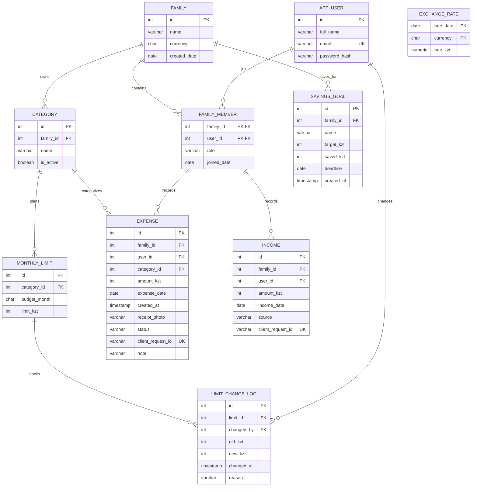

# Database relationships

Expense has composite foreign keys `(family_id, user_id)` → membership and `(family_id, category_id)` → category. Income also references composite household membership. Category names are unique within a household, ignoring case. Monthly limits are unique per category and month. No balance, spending total, or remaining total is persisted.

A savings goal belongs to one household. `saved_kzt` is the source amount for the goal (individual contributions are not kept as rows), so it is stored and changed with a single `UPDATE ... SET saved_kzt = saved_kzt + amount`. Check constraints keep the target between 1 and 1,000,000,000 KZT and the saved amount between 0 and 1,000,000,000 KZT.

`exchange_rate` is a cache of official National Bank of Kazakhstan rates and is not linked to a household. One row is the tenge price of one unit of a currency on one day; the primary key `(rate_date, currency)` prevents duplicates and `rate_kzt` must be positive.
